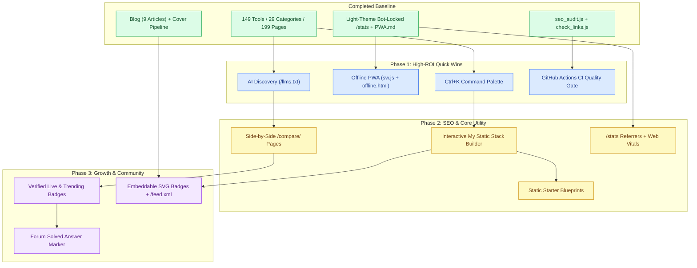

# StaticStack — Website Suggestions & Strategic Roadmap

> **Fresh Outlook:** Strategic enhancements aligned with StaticStack's core philosophy: **zero backend bloat, blazing-fast static pre-rendering, minimal external dependencies, and privacy-respecting architecture.**
> **Current Baseline:** **149 tools** across **29 categories**, **9 blog articles**, **199 compiled HTML pages**, **196 sitemap URLs**, automated SEO auditing (`scripts/seo_audit.js`), automated link health checking (`scripts/check_links.js`), and a light-theme, bot-locked `/stats` analytics dashboard (`src/stats.js`).

---

## 📊 Executive Summary & Status Matrix

| Feature / Enhancement | Category | Impact | Effort | Status |
| :--- | :--- | :---: | :---: | :---: |
| **App Shell & Seamless Page Headers** | UI / Navigation | High | Medium | ✅ **Done** |
| **Archive Description Collapse & TOC Slugs** | Layout / UX | Medium | Low | ✅ **Done** |
| **Dedicated Category Landing Hub Pages (29)** | SEO / Architecture | Very High | Medium | ✅ **Done** |
| **Developer Blog & `1200x630` Cover Pipeline** | Content / SEO | Very High | Medium | ✅ **Done** |
| **Automated Link Health & SEO Audit Scripts** | Reliability / SEO | High | Medium | ✅ **Done** |
| **Light-Theme, Bot-Locked `/stats` Dashboard** | Analytics / Privacy | High | Medium | ✅ **Done** |
| **PWA Spec & `site.webmanifest` Icons** | Architecture | Medium | Low | ✅ **Spec Ready (`PWA.md`)** |
| **AI-Ready `/llms.txt` & `/llms-full.txt`** | AI Discovery / GEO | Very High | Low | ✅ **Done** |
| **Automated CI/CD Quality Gate (GitHub Actions)** | Reliability / DevOps | High | Low | ✅ **Done** |
| **1. Global Quick-Jump Command Palette (`Ctrl+K`)** | UX / Navigation | Very High | Low | ⏳ **Next** |
| **2. Offline PWA Rollout (`sw.js` + `offline.html`)** | Speed / Offline | High | Low | ⏳ **Next** |
| **5. Side-by-Side Tool Comparison (`/compare/`)** | SEO / Content | Very High | Medium | ⏳ **Planned** |
| **6. Interactive "My Static Stack" Builder** | Core Utility | Very High | Medium | ⏳ **Planned** |
| **7. `/stats` Privacy Telemetry & Core Web Vitals** | Analytics / Perf | High | Medium | ⏳ **Planned** |
| **8. Static Starter Blueprints (Copy-Paste Recipes)** | Onboarding / UX | High | Medium | ⏳ **Planned** |
| **9. Verified Live, New & Trending Badges** | Discovery / Trust | Medium | Low | ⏳ **Planned** |
| **10. Embeddable `/badge/<slug>.svg` & `/feed.xml`** | Growth / Syndication | High | Low | ⏳ **Planned** |
| **11. Community Forum "Solved" Answer Marker** | Community / UX | Medium | Low | ⏳ **Planned** |

---

## ✅ Recently Completed Milestones

- **Directory Scale & Category Hubs:** Expanded to **149 tools** across **29 categories**, compiling **199 HTML pages** with **196 indexed sitemap URLs**.
- **Developer Blog & Media Pipeline:** Shipped `blog/index.html` and **9 articles** featuring `1200x630` `cover.webp` banners, developer monospace metadata bars, borderless `.markdown-body` styling, sticky TOC sidebars, and `BlogPosting` JSON-LD structured data, backed by unified `ROOT_DIR` Python scripts (`scripts/build_blog_covers.py`, `scripts/build_og_images.py`, `scripts/capture_tool_covers.py`, `scripts/download_tool_icons.py`).
- **Automated SEO & Link Auditing:** Built `scripts/seo_audit.js` (currently passing with **0 errors**) alongside `scripts/check_links.js` for automated external URL verification.
- **Self-Hosted `/stats` Analytics Dashboard (`src/stats.js`):** Implemented a password-protected, light-theme analytics page linked in the footer (`Site Stats`, `rel="nofollow"`) and locked down from crawlers via `robots.txt` (`Disallow: /stats`), `403` bot User-Agent filtering, `X-Robots-Tag: noindex, nofollow, noarchive, nosnippet`, and `Cache-Control: no-store`.
- **PWA Blueprint (`PWA.md`):** Documented the full offline-first service worker architecture, with `site.webmanifest` and icon assets already in place.

---

## 🚀 Fresh Suggestions & Strategic Roadmap

### 1. Global Quick-Jump Command Palette (`Ctrl+K` / `Cmd+K`)
* **The Problem:** With 149 tools, 29 categories, and 9 blog articles, scrolling or clicking back to the homepage search bar slows down power users.
* **The Solution:** Build a zero-dependency `<dialog>`-based Command Palette triggered via `Ctrl+K` / `Cmd+K` or a header pill button.
* **Key Features:**
  - Instant fuzzy filtering over the pre-built `search-data.json` index (tools, categories, and blog guides).
  - Keyboard-first navigation (`↑`/`↓` to select, `Enter` to navigate, `Esc` to close).
  - Quick actions such as *"Jump to Category"*, *"Open /stats"*, or *"Copy Tool URL"*.

### 2. Complete the Offline PWA Rollout (`PWA.md`)
* **The Problem:** `PWA.md`, `site.webmanifest`, and app icons are already prepared, but `sw.js`, `offline.html`, and `asset/js/pwa.js` are not yet wired up.
* **The Solution:** Implement the documented `PWA.md` specification:
  - **`sw.js`:** Cache-first strategy for static CSS/JS/icons/fonts and stale-while-revalidate for HTML pages and `search-data.json`.
  - **`offline.html`:** Clean fallback page matching StaticStack's light/clean aesthetic when a user visits an uncached route offline.
  - **`asset/js/pwa.js`:** Lightweight registration and non-intrusive update toast when a new build deploys.

### 3. AI-Ready `/llms.txt` & `/llms-full.txt` (Generative Engine Optimization)
* **The Problem:** Developers increasingly ask AI coding assistants (Cursor, Antigravity, Claude, ChatGPT) to recommend static-first tools. Standard HTML/sitemap files are noisy for LLM context windows.
* **The Solution:** Generate `/llms.txt` (concise index of all 29 categories, 149 tools, and 9 blog guides) and `/llms-full.txt` (clean Markdown summaries + URLs) automatically during `npm run build`.
* **Value:** Makes StaticStack the canonical, cleanly structured reference for AI agents recommending static web tooling.

### 4. Automated CI/CD Quality Gate (GitHub Actions)
* **The Problem:** `scripts/check_links.js`, `scripts/seo_audit.js`, and `npm run build` rely on manual execution before deployment.
* **The Solution:** Add a lightweight GitHub Actions workflow:
  - **On Pull Request / Push:** Run `npm run build` and `node scripts/seo_audit.js` to block broken builds, missing meta tags, or sitemap mismatches.
  - **Weekly Scheduled Cron:** Run `node scripts/check_links.js` to catch dead external tool URLs or SSL expirations automatically and flag them before visitors hit 404s.

### 5. Side-by-Side Tool Comparison Pages (`/compare/`)
* **The Problem:** High-intent developer searches are almost always comparative (e.g., *"Formspree vs Basin vs Web3Forms"*, *"Astro vs Hugo vs 11ty"*, *"Cloudflare Pages vs Netlify vs Vercel"*).
* **The Solution:** Pre-render static `/compare/<slug>/` pages from structured tool metadata:
  - Feature matrix: Free tier limits, open-source status, self-hostable flag, build/runtime dependency footprint.
  - Clear *"Best For..."* verdict callouts and direct links back to individual tool pages and relevant blog guides.

### 6. Interactive "My Static Stack" Builder & Starter Export
* **The Problem:** Visitors browsing 29 categories still have to manually track which hosting, forms, auth, CMS, and analytics tools fit together.
* **The Solution:** Add a client-side **"+ Add to Stack"** button on tool cards using `localStorage` (zero backend required):
  - **Shareable URLs:** Encode selected tool slugs in query params (`?stack=cloudflare-pages,astro,decap-cms,web3forms`) so developers can bookmark or share their exact architecture.
  - **One-Click Export:** Copy as a clean `README.md` badge list, JSON manifest, or starter `package.json` / CLI checklist.

### 7. Lightweight Privacy Telemetry & Core Web Vitals on `/stats`
* **The Problem:** The `/stats` dashboard is now light-themed, password-protected, and bot-locked, which creates a safe foundation—but static pageviews alone don't show referrer sources, engagement depth, or real-user speed.
* **The Solution:** Enhance `src/stats.js` with minimal, cookieless `navigator.sendBeacon()` telemetry:
  - **Acquisition & Referrers:** Track top referring domains, UTM/campaign tags, and internal search queries (`search-data.json` misses reveal what tools users want added next).
  - **Real-User Core Web Vitals:** Capture anonymous LCP, INP, and CLS metrics (~1.5 KB `web-vitals` script) to verify every new page stays ultra-fast in the field.

### 8. Static Starter Blueprints (Copy-Paste Architecture Recipes)
* **The Problem:** Beginners and indie hackers often want a proven end-to-end combination rather than picking 149 tools one by one.
* **The Solution:** Create a `/blueprints/` or `/stacks/` section featuring 5–6 opinionated, zero-cost recipes:
  - *Zero-Cost SaaS Landing Page* (Static HTML/Tailwind + Cloudflare Pages + Web3Forms + Turnstile)
  - *Developer Docs & Blog* (Astro/Hugo + GitHub Pages + Giscus + Pagefind)
  - *No-Backend E-Commerce* (11ty + Stripe Payment Links + Snipcart/Lemon Squeezy)
  - Link each blueprint directly to the corresponding tool pages and blog tutorials.

### 9. "Verified Live", "Recently Added" & "Trending" Discovery Badges
* **The Problem:** Static directories feel stale if users cannot tell which tools were recently added or verified working.
* **The Solution:** Surface existing build artifacts directly in the UI:
  - **Verified Live:** Subtle green dot/tooltip powered by `scripts/check_links.js` output (`link-health.json`) showing the last verified check date.
  - **New & Trending:** `New` pill for tools added within the last 30 days, and `Trending` pill driven by `/stats` / `tool-views-cache.json` data.

### 10. Embeddable `/badge/<slug>.svg` & `/feed.xml` RSS/Atom Syndication
* **The Problem:** Listed tool maintainers rarely link back without an easy, attractive asset, and returning developers have no passive way to follow new tools or blog posts.
* **The Solution:**
  - **Static SVG Badges:** Pre-generate `/badge/<slug>.svg` (*"Featured on StaticStack"*) and provide a 1-click Markdown snippet on every tool page for organic backlinks.
  - **RSS / Atom Feed (`/feed.xml`):** Auto-generate an XML feed during `npm run build` covering newly added tools and all blog articles.

### 11. Community Forum "Solved" Answer Marker
* **The Problem:** Help threads in the community forum require reading through full comment chains to find the working answer.
* **The Solution:** Allow thread authors or moderators to mark one reply as the **Accepted Solution**, pinning a green `"✓ Solved"` badge to the thread list and surfacing the solution directly beneath the original question.

---

## 🗺️ Phased Implementation Roadmap

