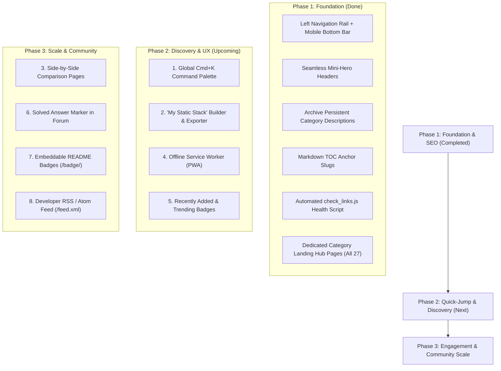

# StaticStack — Website Suggestions & Strategic Roadmap

This document outlines high-impact, practical suggestions and feature enhancements for **StaticStack (`staticstack.app`)**. All suggestions strictly adhere to StaticStack's core philosophy: **zero-backend bloat, blazing-fast static pre-rendering, minimal external dependencies, and privacy-respecting client-side architecture.**

---

## 🧭 Executive Summary & Status Matrix

| Initiative | Status | Impact | Effort | Architecture / Tech | Target Area |
| :--- | :---: | :---: | :---: | :--- | :--- |
| **App Shell Redesign (Left Rail + Bottom Bar)** | ✅ **Done** | ⚡ High | 🟡 Medium | Fixed 68px Rail + Mobile Bottom Bar | Global Shell & Navigation |
| **Seamless / Borderless Page Headers** | ✅ **Done** | ⚡ High | 🟢 Low | Native Body Canvas + Breathing Room | Sub-Pages & Tool Details |
| **Archive Description on Collapse** | ✅ **Done** | ⚡ Medium | 🟢 Low | Header Flex Restructure | Master Archive Discovery |
| **Markdown TOC Anchor Link Slugs** | ✅ **Done** | ⚡ Medium | 🟢 Low | Custom `marked` Heading Renderer | Docs & Contributing Guide |
| **Automated Link Health Checker (`check_links.js`)** | ✅ **Done** | 🛡️ High | 🟢 Low | Standalone Node Script (`http/https`) | Catalog Health & QA |
| **Dedicated Category Landing Hub Pages** | ✅ **Done** | 🚀 High | 🟡 Medium | Pre-rendered static compilation pipeline | SEO & Search Impressions |
| **1. Command Palette (`Ctrl+K` / `Cmd+K`)** | 🚀 **Next** | ⚡ High | 🟢 Low | Vanilla JS + `<dialog>` (~4 KB) | Global Navigation / UX |
| **2. Interactive "My Static Stack" Builder** | 📋 Planned | 🚀 High | 🟡 Medium | Client-Side `localStorage` | Tool Discovery & Engagement |
| **3. Side-by-Side Tool Comparison (`/compare/`)** | 📋 Planned | 🚀 High | 🟡 Medium | Pre-rendered static pages | SEO & Decision Making |
| **4. PWA & Offline Developer Reference** | 📋 Planned | ⚡ High | 🟢 Low | Cache-First Service Worker (`sw.js`) | Performance & Offline Utility |
| **5. "Recently Added" & "Trending" Badges** | 📋 Planned | ⚡ Medium | 🟢 Low | Build step + `tool-views-cache.json` | Home & Archive Discovery |
| **6. "Solved" Answer Marker in Forum** | 📋 Planned | 💬 High | 🟡 Medium | Postgres flag + Community UI | StaticStack Support Channel |
| **7. Embeddable Readme Badges & Cards** | 📋 Planned | ⚡ Medium | 🟢 Low | Static SVG endpoint (`/badge/<tool>.svg`) | Viral Growth & Backlinks |
| **8. RSS & Atom Updates Feed (`/feed.xml`)** | 📋 Planned | ⚡ Medium | 🟢 Low | Pre-rendered XML syndication | Developer Subscriptions |

---

## 🎯 Recently Completed Implementations

### ✅ Modern App Shell: Left Icon Rail + Mobile Bottom Bar
- **Desktop (≥ 768px)**: 68px fixed vertical icon rail with clean flat outline SVG icons, active indicator pills, and animated slide-out tooltips on hover (`translateX(6px)`).
- **Mobile (< 768px)**: Automatically converts to a sticky bottom navigation bar with thumb-friendly tab access and floating `+` action button.
- **Seamless Canvas**: Eliminated heavy boxed header strips on desktop; page headings and breadcrumbs now sit directly on the body background.

### ✅ Persistent Category Descriptions on Archive Collapse
- Relocated `<p class="archive-cat-desc">` inside `.archive-cat-header-main`.
- When users click to collapse category tables, the icon, title, tool count pill, and descriptive summary remain visible.

### ✅ Automatic Heading Slugs & Smooth Scroll Anchors
- Added a GitHub-compatible heading renderer to `marked` in `generate-pages.js`.
- Automatically assigns clean IDs and handles dual-slug aliases (e.g., `#entry-format--template`, `#how-to-submit-via-an-issue`).
- Added `scroll-margin-top` for smooth in-page navigation.

### ✅ Automated Link & SSL Health Checker (`check_links.js`)
- Standalone Node utility pinging all 130 tool external links.
- Verified 126 online tools and logged results to `asset/json/link-health.json`.

### ✅ Dedicated Category Landing Hub Pages (`/category/<slug>/index.html`)
- **Complete Catalog Coverage**: Pre-rendered dedicated static landing pages for all 27 categories across StaticStack (`/category/<slug>/index.html`) with zero backend dependencies.
- **Rich Mini-Hero Header**: Displays the custom category SVG icon, breadcrumb navigation, tool count, open-source/free-tier stats, and quick actions ("Submit Tool", "View in Archive", "Community Discuss").
- **Top 3 Featured Picks Showcase**: Prominently highlights standout tools (e.g. "Top Choice", "Open Source Pick", "Free Tier Available") with cover preview screenshots, badges, view metrics, and direct links.
- **Interactive Directory & Live Filter**: Real-time keyword filter across tool names, descriptions, tags, and pricing badges (`All`, `Open Source`, `Free`, `Freemium`, `Paid`) with dynamic counters and empty-state handling.
- **Category Developer FAQ**: Tailored questions and answers addressing static site integration, zero-backend architecture, and API security, accompanied by Schema.org `FAQPage` + `CollectionPage` JSON-LD for rich search engine snippets.
- **Related Categories Strip**: Suggests adjacent static categories (e.g., Contact Forms recommending Email, Auth, and Surveys) to encourage natural exploration.
- **Site-Wide Cross-Linking**: Homepage category cards, tool detail breadcrumbs and badges, Archive table headers (`Hub →`), `sitemap.xml` (0.85 priority), and `search-data.json` now link directly to canonical category pages.

---

## 1. 🔍 Global Quick-Jump Command Palette (`Ctrl+K` / `Cmd+K`) — *Recommended Next*

### The Vision
Developers love keyboard-first workflows. Adding a lightweight, instant command palette allows visitors to jump to any of the 130+ tools, 27 categories, or community channels from anywhere on the site with zero latency.

### Key Capabilities
- **Universal Shortcut**: Triggered via `Cmd+K` (macOS), `Ctrl+K` (Windows/Linux), or by clicking the search button on the desktop left rail / hero.
- **Instant Client-Side Filtering**: Searches across tool names, categories, tags, and pricing models using the existing lightweight `search-data.json` or `tools-data.json`.
- **Keyboard Navigation**: Full arrow key selection (`↑` / `↓`), `Enter` to navigate, and `Esc` to dismiss.
- **Zero Dependencies**: Implemented using HTML5 `<dialog>` and vanilla JavaScript (~4 KB uncompressed), avoiding heavy external libraries like Algolia DocSearch or Ninja Keys.

### Implementation Blueprint
```html
<!-- Modal Template in src/templates/layout.js -->
<dialog id="command-palette" class="palette-dialog">
  <div class="palette-input-wrap">
    <svg class="palette-search-icon" width="18" height="18"><use href="#ico-search"/></svg>
    <input type="text" id="palette-search" placeholder="Type a tool name, category, or #tag (e.g. 'supabase', 'forms')..." autocomplete="off">
    <kbd class="palette-kbd">ESC</kbd>
  </div>
  <div id="palette-results" class="palette-results-list"></div>
</dialog>
```

---

## 2. 🧰 Interactive "My Static Stack" Builder & Exporter

### The Vision
Turn StaticStack from a static directory into an active developer workbench. Let users curate their preferred static stack (e.g. SSG + Hosting + Contact Form + Comments + Analytics + Auth), see an instant architecture preview, and export a ready-to-run project blueprint.

### Key Capabilities
- **One-Click Bookmark / Star**: Add a small bookmark/plus toggle icon on every tool card and tool detail page.
- **Local Persistence**: Saves selected tools in the browser's `localStorage` (100% private, no account or database required).
- **Architecture Drawer**: A slide-out panel showing the visitor's currently assembled stack:
  - *Generator*: Astro
  - *Hosting*: Cloudflare Pages
  - *Auth*: Outseta
  - *Forms*: Splitform
  - *Comments*: Giscus
  - *Analytics*: CountAPI
- **Export Options**:
  1. **Markdown**: Copy a clean `STACK.md` snippet for GitHub READMEs.
  2. **HTML Starter Template**: Download a minimal `index.html` boilerplate pre-configured with the selected embed scripts and CDN tags.
  3. **Shareable Deep Link**: Generate a URL containing base64-encoded tool slugs (`staticstack.app/?stack=astro,splitform,outseta`) so developers can share their recommended static stack with colleagues.

---

## 3. ⚖️ Side-by-Side Tool Comparison Engine (`/compare/`)

### The Vision
When developers build static sites, they frequently ask: *"Should I use Formspree or Splitform?"*, *"Umami or Plausible?"*, *"Decap CMS or Pages CMS?"*. Dedicated comparison matrices capture high-intent search queries and offer immediate clarity.

### Key Capabilities
- **Curated Top Comparisons**:
  - `Formspree vs Splitform vs Basin` (Static Contact Forms)
  - `Umami vs Plausible vs CountAPI` (Privacy Analytics)
  - `Decap CMS vs Pages CMS vs CraftPages` (Git-backed CMS)
  - `Giscus vs Utterances vs Disqus` (Comment Platforms)
  - `Cloudflare Pages vs GitHub Pages vs Vercel` (Static Hosting)
- **Structured Matrix View**:
  - Pricing & Free Tier Limits
  - Self-Hosting Capability (Yes / No / Docker)
  - Zero-Backend Compatibility Score
  - Official CDN & Embed Size
- **SEO Value**: Targets lucrative long-tail search queries (e.g., *"free formspree alternative for static site"*), funneling organic search traffic directly into the directory.

---

## 4. ⚡ Offline PWA & Zero-Latency Developer Reference

### The Vision
Static web developers often code on airplanes, trains, or in coffee shops with spotty internet. Making StaticStack an installable Progressive Web Application (PWA) turns it into an indispensable offline reference.

### Key Capabilities
- **Lightweight Service Worker (`sw.js`)**:
  - Cache core pre-compressed assets (`index.html`, `archive/index.html`, `asset/css/style.css`, and `asset/json/tools-data.json`).
  - Cache visited tool pages using a **Stale-While-Revalidate** strategy.
- **Native Install Experience**:
  - Uses the existing `site.webmanifest` and crisp favicon icons to prompt mobile and desktop users to "Add to Home Screen / Install App".
- **Zero Performance Penalty**: The service worker is only ~60 lines of standard Cache API code, adding zero runtime dependencies.

---

## 5. 🏷️ "Recently Added" & "Trending" Badges

### The Vision
Keep the catalog feeling fresh and active by highlighting indie additions and newly released developer tools.

### Key Capabilities
- **`New` Badge**: Tools added within the last 30 days automatically display a subtle green badge:
  ```html
  <span class="badge badge-new" style="background:#ecfdf5; color:#059669; border:1px solid #a7f3d0;">New</span>
  ```
- **"Recently Added" Filter**: Add a quick filter chip on the Archive page:
  `[ All Tools ] [ Open Source ] [ Free ] [ Freemium ] [ Paid ] [ ✨ Recently Added ]`
- **Dynamic Trending Ranking**: Leverage the existing `tool-views-cache.json` to showcase a "Trending This Week" spotlight section on the homepage.

---

## 6. 💬 "Solved" Marker & FAQ Workflow for the Community Forum

### The Vision
With the newly launched **StaticStack Support** and **Help & Questions** channels, users will frequently ask how to integrate tools, resolve CORS issues, or configure deployment workflows.

### Key Capabilities
- **Accepted Solution Checkmark**:
  - Topic authors or admins can click a **"Mark as Accepted Answer"** button on any reply.
  - Adds a green `✓ Solved` pill next to the topic title on `/community/` and on `/community/topic/?id=...`.
  - Pinned solution preview box directly below the original post for instant reading.
- **"Unanswered" Filter Tab**:
  - Allows maintainers and community advocates to filter for topics with zero replies or without an accepted answer.
- **Direct Cross-Linking from Tool Pages**:
  - On tool pages (e.g. `tools/authentication-users/outseta.html`), display a contextual link:
    `"Have questions about Outseta? Ask in the community →"` with pre-filled category and tag parameters.

---

## 7. 🏷️ Embeddable StaticStack Badges for Tool Authors (`/badge/`)

### The Vision
Tool authors love showcasing directory badges on their GitHub READMEs (e.g., *"Featured on StaticStack"*). This drives viral visibility, organic backlinks, and brand authority back to StaticStack with zero server runtime.

### Key Capabilities
- **Static SVG Badges**:
  - `https://www.staticstack.app/badge/<tool-slug>.svg` (e.g. `[](https://www.staticstack.app/tools/contact-forms/splitform)`)
  - Crisp, accessible shields.io-compatible styling with the StaticStack logo and live category tag.
- **Copy-Paste Snippet on Tool Pages**:
  - On each tool documentation page, provide a one-click "Embed Badge" copy box with Markdown and HTML snippets for READMEs.

---

## 8. 📰 Developer RSS & Atom Feeds (`/feed.xml`, `/atom.xml`)

### The Vision
Developers love RSS readers (NetNewsWire, Feedly, Slack channels) for discovering new web tools and static APIs without social media noise or newsletters.

### Key Capabilities
- **Pre-Rendered Feed Output**:
  - `generate-pages.js` compiles `/feed.xml` containing the 20 most recently added or updated static tools.
  - Includes tool description, category, tags, and direct links.
- **Zero Overhead**: Pure XML file output, perfectly compatible with standard static hosting.

---

## 📋 Strategic Implementation Roadmap



---

*Authored for the StaticStack Open-Source Project. Suggestions are modular and strictly maintain zero-backend bloat.*
