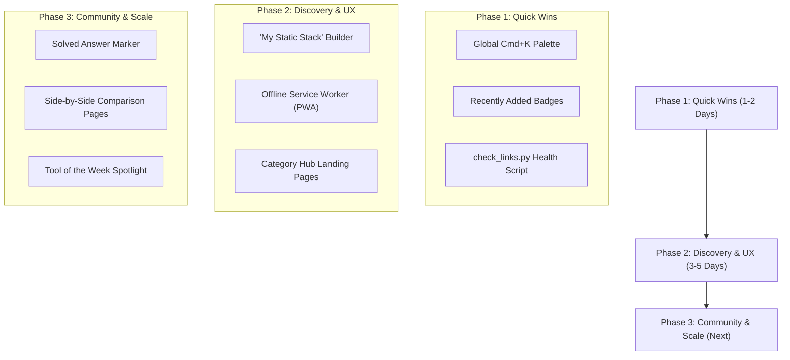

# StaticStack — Website Suggestions & Strategic Roadmap

This document outlines high-impact, practical suggestions and feature enhancements for **StaticStack (`staticstack.app`)**. All suggestions strictly adhere to StaticStack's core philosophy: **zero-backend bloat, blazing-fast static pre-rendering, minimal external dependencies, and privacy-respecting client-side architecture.**

---

## 🧭 Executive Summary & Opportunity Matrix

| Initiative | Impact | Effort | Architecture / Tech | Target Area |
| :--- | :---: | :---: | :--- | :--- |
| **1. Command Palette (`Ctrl+K` / `Cmd+K`)** | ⚡ High | 🟢 Low | Vanilla JS + `<dialog>` | Global Navigation / UX |
| **2. Interactive "My Static Stack" Builder** | 🚀 High | 🟡 Medium | Client-Side `localStorage` | Tool Discovery & Engagement |
| **3. Side-by-Side Tool Comparison (`/compare`)** | 🚀 High | 🟡 Medium | Pre-rendered static pages | SEO & Decision Making |
| **4. PWA & Offline Developer Reference** | ⚡ High | 🟢 Low | Cache-First Service Worker | Performance & Offline Utility |
| **5. "Recently Added" & "Trending" Badges** | ⚡ Medium | 🟢 Low | `generate-pages.js` build step | Home & Archive Discovery |
| **6. Automated Dead-Link & SSL Health Checker** | 🛡️ High | 🟢 Low | Standalone Python / Node script | Catalog Maintenance & Quality |
| **7. "Solved" Answer Marker in Support Forum** | 💬 High | 🟡 Medium | Postgres flag + Community UI | StaticStack Support Channel |
| **8. Dedicated Category Landing Pages** | 🚀 High | 🟡 Medium | Static compilation pipeline | SEO & Search Impressions |

---

## 1. 🔍 Global Quick-Jump Command Palette (`Ctrl+K` / `Cmd+K`)

### The Vision
Developers love keyboard-first workflows. Adding a lightweight, instant command palette allows visitors to jump to any of the 130+ tools, 27 categories, or community channels from anywhere on the site with zero latency.

### Key Capabilities
- **Universal Shortcut**: Triggered via `Cmd+K` (macOS), `Ctrl+K` (Windows/Linux), or by clicking a search shortcut pill in the top header.
- **Instant Client-Side Filtering**: Searches across tool names, categories, tags, and pricing models using the existing lightweight `search-data.json` or `tools-data.json`.
- **Keyboard Navigation**: Full arrow key selection (`↑` / `↓`), `Enter` to navigate, and `Esc` to dismiss.
- **Zero Dependencies**: Implemented using HTML5 `<dialog>` and vanilla JavaScript (~4 KB uncompressed), avoiding heavy external libraries like Algolia DocSearch or Ninja Keys.

### Implementation Blueprint
```html
<!-- Modal Template in src/templates/layout.js -->
<dialog id="command-palette" class="palette-dialog">
  <div class="palette-input-wrap">
    <svg class="palette-search-icon" width="18" height="18"><use href="#ico-search"/></svg>
    <input type="text" id="palette-search" placeholder="Type a tool name, category, or #tag (e.g. 'supabase', 'forms')..." autocomplete="off">
    <kbd class="palette-kbd">ESC</kbd>
  </div>
  <div id="palette-results" class="palette-results-list"></div>
</dialog>
```

---

## 2. 🧰 Interactive "My Static Stack" Builder & Exporter

### The Vision
Turn StaticStack from a static directory into an active developer workbench. Let users curate their preferred static stack (e.g. SSG + Hosting + Contact Form + Comments + Analytics + Auth), see an instant architecture preview, and export a ready-to-run project blueprint.

### Key Capabilities
- **One-Click Bookmark / Star**: Add a small star/bookmark toggle icon on every tool card and tool detail page.
- **Local Persistence**: Saves selected tools in the browser's `localStorage` (100% private, no account or database required).
- **Architecture Drawer**: A slide-out panel showing the visitor's currently assembled stack:
  - *Generator*: Astro
  - *Hosting*: Cloudflare Pages
  - *Auth*: Outseta
  - *Forms*: Splitform
  - *Comments*: Giscus
  - *Analytics*: CountAPI
- **Export Options**:
  1. **Markdown**: Copy a clean `STACK.md` snippet for GitHub READMEs.
  2. **HTML Starter Template**: Download a minimal `index.html` boilerplate pre-configured with the selected embed scripts and CDN tags.
  3. **Shareable Deep Link**: Generate a URL containing base64-encoded tool slugs (`staticstack.app/?stack=astro,splitform,outseta`) so developers can share their recommended static stack with colleagues.

---

## 3. ⚖️ Side-by-Side Tool Comparison Engine (`/compare/`)

### The Vision
When developers build static sites, they frequently ask: *"Should I use Formspree or Splitform?"*, *"Umami or Plausible?"*, *"Decap CMS or Pages CMS?"*. Dedicated comparison matrices capture high-intent search queries and offer immediate clarity.

### Key Capabilities
- **Curated Top Comparisons**:
  - `Formspree vs Splitform vs Basin` (Static Contact Forms)
  - `Umami vs Plausible vs CountAPI` (Privacy Analytics)
  - `Decap CMS vs Pages CMS vs CraftPages` (Git-backed CMS)
  - `Giscus vs Utterances vs Disqus` (Comment Platforms)
  - `Cloudflare Pages vs GitHub Pages vs Vercel` (Static Hosting)
- **Structured Matrix View**:
  - Pricing & Free Tier Limits
  - Self-Hosting Capability (Yes / No / Docker)
  - Zero-Backend Compatibility Score
  - Official CDN & Embed Size
- **SEO Value**: Targets lucrative long-tail search queries (e.g., *"free formspree alternative for static site"*), funneling organic search traffic directly into the directory.

---

## 4. ⚡ Offline PWA & Zero-Latency Developer Reference

### The Vision
Static web developers often code on airplanes, trains, or in coffee shops with spotty internet. Making StaticStack an installable Progressive Web Application (PWA) turns it into an indispensable offline reference.

### Key Capabilities
- **Lightweight Service Worker (`sw.js`)**:
  - Cache the pre-compressed core assets (`index.html`, `archive/index.html`, `asset/css/style.css`, and `asset/json/tools-data.json`).
  - Cache visited tool pages using a **Stale-While-Revalidate** strategy.
- **Native Install Experience**:
  - Uses the existing `site.webmanifest` and crisp favicon icons to prompt mobile and desktop users to "Add to Home Screen / Install App".
- **Zero Performance Penalty**: The service worker is only ~60 lines of standard Cache API code, adding zero runtime dependencies.

---

## 5. 🏷️ "Recently Added" & "Trending" Badges

### The Vision
Keep the catalog feeling fresh and active by highlighting indie additions and newly released developer tools.

### Key Capabilities
- **`New` Badge**: Tools added within the last 30 days (e.g., SMTP2GO, Emdash, DesignCraft) automatically display a subtle glowing green badge:
  ```html
  <span class="badge badge-new" style="background:#ecfdf5; color:#059669; border:1px solid #a7f3d0;">New</span>
  ```
- **"Recently Added" Filter**: Add a quick filter chip on the Archive page:
  `[ All Tools ] [ Open Source ] [ Free ] [ Freemium ] [ Paid ] [ ✨ Recently Added ]`
- **Dynamic Trending Ranking**: Leverage the existing `tool-views-cache.json` to showcase a "Trending This Week" spotlight section on the homepage.

---

## 6. 🛡️ Automated Dead-Link & SSL Health Checker (`check_links.py`)

### The Vision
Third-party SaaS tools and open-source landing pages change domains, rebrand, or shut down. An automated health check ensures StaticStack's 130+ external links never return 404s or expired SSL certificates.

### Key Capabilities
- **Headless HTTP Ping**: Sends asynchronous `HEAD` / `GET` requests to each tool's `websiteUrl` with standard user-agent headers.
- **Failure Classification**:
  - `200 OK`: Healthy.
  - `301 / 302`: Permanent or temporary redirect (detects rebrands or domain migrations).
  - `404 / 500`: Dead link / server downtime.
  - `SSL Error`: Expired or misconfigured TLS certificate.
- **Execution Mode**: Run locally via `python check_links.py` or as a weekly scheduled GitHub Action that outputs a concise markdown health report.

---

## 7. 💬 "Solved" Marker & FAQ Workflow for the Community Forum

### The Vision
With the newly launched **StaticStack Support** and **Help & Questions** channels, users will frequently ask how to integrate tools, resolve CORS issues, or configure deployment workflows.

### Key Capabilities
- **Accepted Solution Checkmark**:
  - Topic authors or admins can click a **"Mark as Accepted Answer"** button on any reply.
  - Adds a green `✓ Solved` pill next to the topic title on `/community/` and on `/community/topic/?id=...`.
  - Pinned solution preview box directly below the original post for instant reading.
- **"Unanswered" Filter Tab**:
  - Allows maintainers and community advocates to filter for topics with zero replies or without an accepted answer.
- **Direct Cross-Linking from Tool Pages**:
  - On tool pages (e.g. `tools/authentication-users/outseta.html`), display a contextual link:
    `"Have questions about Outseta? Ask in the community →"` with pre-filled category and tag parameters.

---

## 8. 🌐 Category Landing Hub Pages (`/category/<slug>/`)

### The Vision
Currently, clicking a category jumps to an anchor on `/archive#category`. Creating dedicated indexable category pages provides dedicated landing pages with tailored metadata, OpenGraph cards, and introductory guides.

### Key Capabilities
- **Canonical SEO Targets**: Dedicated URLs like `staticstack.app/category/authentication-users/` or `staticstack.app/category/contact-forms/`.
- **Top 3 Recommended Stack Picks**: Highlight the "Best Overall", "Best Open Source", and "Best Free Tier" for that specific category.
- **Category FAQ**: 3–4 quick, schema-marked questions (e.g., *"Can I collect form submissions without a backend?"*), which Google frequently features as Rich Snippet answers.

---

## 📋 Suggested Implementation Phases



---

*Authored for the StaticStack Open-Source Project. Suggestions are modular and can be implemented independently without breaking existing catalog architecture.*

