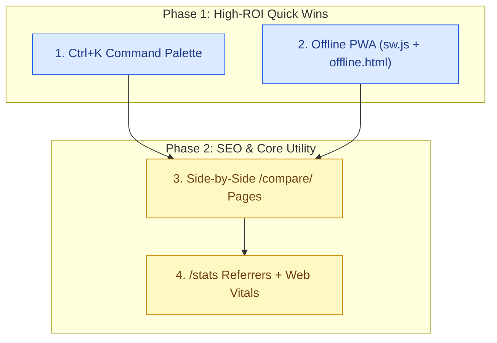

# StaticStack — Website Suggestions & Strategic Roadmap

> **Philosophy:** Zero backend bloat, blazing-fast static pre-rendering, minimal external dependencies, and privacy-respecting architecture.
> **Current Baseline:** **159 tools** across **29 categories**, **10 blog articles** (including the 7-part *Static HTML Starter Series*), **211 compiled HTML pages**, **208 sitemap URLs**, `/llms.txt` & `/llms-full.txt`, `/feed.xml` RSS 2.0 feed, per-tool `/badge/<slug>.svg` badges (`badge/featured.webp`), automated SEO & dead-link CI/CD gates, GitHub-synced `/stack/` bookmarks, and a light-theme, bot-locked `/stats` analytics dashboard (`src/stats.js`).

---

## 📊 Upcoming Suggestions & Status Matrix

| Feature / Enhancement | Category | Impact | Effort | Status |
| :--- | :--- | :---: | :---: | :---: |
| **1. Global Quick-Jump Command Palette (`Ctrl+K`)** | UX / Navigation | Very High | Low | ⏳ **Next** |
| **2. Offline PWA Rollout (`sw.js` + `offline.html`)** | Speed / Offline | High | Low | ⏳ **Next** |
| **3. Side-by-Side Tool Comparison (`/compare/`)** | SEO / Content | Very High | Medium | ⏳ **Planned** |
| **4. `/stats` Privacy Telemetry & Core Web Vitals** | Analytics / Perf | High | Medium | ⏳ **Planned** |

---

## 🚀 Strategic Roadmap

### 1. Global Quick-Jump Command Palette (`Ctrl+K` / `Cmd+K`)
* **The Problem:** With 159 tools, 29 categories, and 10 blog articles, scrolling or clicking back to the homepage search bar slows down power users.
* **The Solution:** Build a zero-dependency `<dialog>`-based Command Palette triggered via `Ctrl+K` / `Cmd+K` or a header pill button.
* **Key Features:**
  - Instant fuzzy filtering over the pre-built `search-data.json` index (tools, categories, and blog guides).
  - Keyboard-first navigation (`↑`/`↓` to select, `Enter` to navigate, `Esc` to close).
  - Quick actions such as *"Jump to Category"* or *"Copy Tool URL"*.

### 2. Complete the Offline PWA Rollout (`PWA.md`)
* **The Problem:** `PWA.md`, `site.webmanifest`, and app icons are already prepared, but `sw.js`, `offline.html`, and `asset/js/pwa.js` are not yet wired up.
* **The Solution:** Implement the documented `PWA.md` specification:
  - **`sw.js`:** Cache-first strategy for static CSS/JS/icons/fonts and stale-while-revalidate for HTML pages and `search-data.json`.
  - **`offline.html`:** Clean fallback page matching StaticStack's light/clean aesthetic when a user visits an uncached route offline.
  - **`asset/js/pwa.js`:** Lightweight registration and non-intrusive update toast when a new build deploys.

### 3. Side-by-Side Tool Comparison Pages (`/compare/`)
* **The Problem:** High-intent developer searches are almost always comparative (e.g., *"Formspree vs Basin vs Web3Forms"*, *"Astro vs Hugo vs 11ty"*, *"Cloudflare Pages vs Netlify vs Vercel"*).
* **The Solution:** Pre-render static `/compare/<slug>/` pages from structured tool metadata:
  - Feature matrix: Free tier limits, open-source status, self-hostable flag, build/runtime dependency footprint.
  - Clear *"Best For..."* verdict callouts and direct links back to individual tool pages and relevant blog guides.

### 4. Lightweight Privacy Telemetry & Core Web Vitals on `/stats`
* **The Problem:** The `/stats` dashboard is light-themed, password-protected, and bot-locked, which creates a safe foundation—but static pageviews alone don't show referrer sources, engagement depth, or real-user speed.
* **The Solution:** Enhance `src/stats.js` with minimal, cookieless `navigator.sendBeacon()` telemetry:
  - **Acquisition & Referrers:** Track top referring domains, UTM/campaign tags, and internal search queries (`search-data.json` misses reveal what tools users want added next).
  - **Real-User Core Web Vitals:** Capture anonymous LCP, INP, and CLS metrics (~1.5 KB `web-vitals` script) to verify every new page stays ultra-fast in the field.

---

## 🗺️ Phased Implementation Roadmap

